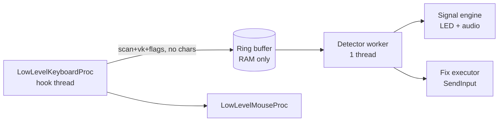

# SmartBlink Architecture

> Renamed from SmartPunto on 2026-10-23 (trademark distance from "Punto Switcher").

Product: Windows tray utility that detects text typed in the wrong keyboard layout (user looks at keyboard, not screen), signals via Caps/Scroll LED blink + muted low-frequency click, and fixes only on explicit user gesture.

Status: Phase 0 design. No application code yet. This file is the single source of truth for architecture; `AGENTS.md` holds process rules.

## 1. Stack Decision

| Layer | Choice | Reason |
|---|---|---|
| Language | **Rust** (edition 2021), MSVC target `x86_64-pc-windows-msvc`, CRT static | Native `.exe`, no .NET/JVM runtime, release binary ~1–3 MB, RSS target <5 MB. Safe concurrency for hook thread ↔ worker thread. |
| WinAPI | `windows` crate (official Microsoft), features limited to what we use | No hand-written bindings drift; direct `WH_KEYBOARD_LL`, `Shell_NotifyIconW`, `ToUnicodeEx`. |
| UI | Pure Win32: tray (`Shell_NotifyIconW`) + one Settings window created with `CreateWindowExW` (no GUI framework) | Zero dependencies, small footprint. Hotkey dialog is a single dialog template in a `.rc`. |
| Config | TOML via `toml` crate at `%APPDATA%\SmartBlink\config.toml` | Human-editable, atomic rewrite. |
| Audio | WASAPI shared-mode render client + in-memory PCM (16-bit mono 48 kHz, ~30 ms precomputed ring) | No `PlaySound` file I/O, no mixer latency surprises. Fallback: `waveOut` if WASAPI init fails. |
| Installer | **Inno Setup 6**, `PrivilegesRequired=lowest` (per-user default), optional admin override dialog | Smallest proven installer, native uninstall registration, `/SILENT` for CI. WiX rejected: heavier MSI toolchain; NSIS rejected: weaker uninstall registry defaults. |
| Build | `cargo` + `rc.exe`/`link.exe`; GitHub Actions `windows-latest` runner produces `SmartBlink-Setup.exe` artifact | Reproducible release pipeline. |

Rejected: C++ (build fragility, memory-safety risk in a global hook), C# NativeAOT (still larger image + WinRT projections churn), AutoHotkey/Electron (banned by size/runtime constraints).

## 2. Process & Threading Model



- **Hook thread** owns `WH_KEYBOARD_LL` and `WH_MOUSE_LL`. It never calls detection, audio, or file IO. Cost budget per key: <0.1 ms (only append to ring buffer + timestamp). Return immediately; hooks run in the input path — any blocking causes system-wide input lag.
- **Worker thread** runs a 30 Hz tick and on-demand wakeups: word segmentation, hypothesis scoring, signal decisions.
- **No synchronous cross-thread calls into the hook.** Shared state is a lock-free SPSC ring of fixed-size records (`vk`, `scan_code`, `flags`, `ms_tick`, `layout_hkl_snapshot`).

### Recursion & injection safety
- Synthetic input we inject (fix replay) is marked with injected/backup flags; hook checks `LLKHF_INJECTED | LLKHF_LOWER_IL_INJECTED` and ignores those events for detection, but the fix executor tracks its own injected sequence IDs so it knows what to suppress.
- Fix replay path: `SendInput` per character via `KEYEVENTF_UNICODE` (no layout dependency), bracketed by a "suppression window" counter so the hook drops exactly our synthetic events even if another app re-injects.

### Word buffer lifecycle (hard reset rules)
Reset on any of: left-button mouse down (`WM_LBUTTONDOWN` from mouse hook), arrow/navigation key, `Ctrl`/`Alt`/`Win` modifier chord, character typed while a modifier was held, token prefixes (`http`, `www.`, paths with `\`), idle timeout (default 3.5 s), focus change to a different HWND, or password field detected. Buffer holds only scan codes + timestamps — never plaintext on disk.

## 3. WinAPI Subsystems

### 3.1 Layout identification
- `GetKeyboardLayoutList` at startup and on `WM_SETTINGCHANGE`; each HKL mapped to its primary/sublang and its layout name (`GetLocaleInfoEx(LOCALE_NAME...)` + `KBD_LAYOUT_*`). Active-layout set is the hypothesis space: we never score layouts the user has not installed.
- Per-window layout: `GetForegroundWindow` → `GetWindowThreadProcessId` → `GetWindowThreadInput`/`GetKeyboardLayout(tid)`. Target layout for a fix is chosen by scoring, then applied with `ActivateKeyboardLayout(hkl, KBD_ALTERNATE)` plus `PostMessage(hwnd, WM_INPUTLANGCHANGEREQUEST, 0, hkl)` so the target window (not just our thread) switches.
- Fallback when the guessed layout is not in the user's list: we still convert text correctly and show a tray balloon "install this layout" instead of failing silently.

### 3.2 Character mapping without N*(N-1) tables
Core primitive, one call per keystroke:

```
ToUnicodeEx(vk, scan_code | (LLKHF_EXTENDED ? 0xE000 : 0), key_state, buf, 4,
            UNICODE_NO_CHANGED_STATE /* flag bit 2 */, hkl_candidate)
```

Engineering constraints (verified against Win32 docs):
- `KBDLLHOOKSTRUCT.scanCode` omits the `0xE0` prefix; extended keys must be reconstructed as `0xE0xx`, otherwise numpad `/`, arrows, and right-Ctrl/Alt translate to the wrong glyph. Use `MAPVK_VK_TO_VSC_EX` when we need scan codes derived from VKs.
- `ToUnicodeEx` mutates dead-key state; always pass the no-state-change flag (Windows 10 1607+). Our minimum target is Windows 10 1809, so this is unconditional.
- Dead keys: on `VK_DEAD*` we record the pending dead key and resolve it against the candidate layout's accent table at the next keystroke; a dead-key prefix disables scoring until resolved.
- Return value semantics: `-1` = no glyph (dead key), `>0` = glyph produced. We build, per candidate HKL, a 256-entry layer table (`base/shift/ctrl-alt/ctrl-shift`) lazily and cache it per layout — cost is O(1) per keystroke after first use.

Detection algorithm:
1. Segment the physical scan-code buffer into words (whitespace/punctuation boundaries; punctuation kept as a token class).
2. For each candidate layout L in the user's active set, render the word with L via the cached layer table → string `w_L`.
3. Score `w_L` against L's own language profile (bigram/trigram log-probability + shape penalties). Also score against "any Latin output" for intra-script cases (`QWERTY` vs `QWERTZ` vs `AZERTY`).
4. Decision: winner hypothesis must beat the runner-up by a margin and exceed an absolute threshold; otherwise stay silent (no signal, no fix). This is what prevents German/French/US false positives among Latin layouts — same script, different key mapping, resolved by profile scoring rather than by guessing.
5. Expected target layout = the layout of the winner hypothesis; current window layout = actual. Signal only when they differ and confidence ≥ threshold.

Complexity: candidates ≤ user's installed layouts (typically 2–4), word length ≤ 64 → well under 0.1 ms with cached tables and a flat-array bigram lookup.

### 3.3 Language profiles (20 out-of-the-box)
Profiles shipped as embedded binary blobs, one file per language, total budget <600 KB:
- Format: sorted `(u16 bigram key → i8 log-prob quantized)` and `(u32 trigram key → i8)` flat arrays + a small alphabet bitmap + a script tag (Latin/Cyrillic/Armenian/Georgian/Hebrew/Arabic/Greek/Thai/Hangul/Devanagari).
- Generation: offline Rust tool (`tools/profilegen`) from public corpora under permissive licenses; output checked in as `assets/profiles/*.bin`. License provenance recorded in `assets/profiles/LICENSES.md`. No corpus text ships.
- Cross-script detection is trivial (alphabet bitmap mismatch ⇒ strong hypothesis). Intra-Latin (DE/FR/ES/PT/IT/TR/PL/Nordic/UK) relies on trigram + diacritic signatures (`ä ö ß`, `é è ç`, `ñ`, `ç ğ ı ş`, `ł ż ś`, `å ä ö`).
- Korean 2-bulsik and Devanagari use syllable/joiner-aware segmentation; Hangul jamo sequences are scored per-syllable block.

### 3.4 Alert channels
1. **LED blink:** default channel is **Scroll Lock** — toggling it cannot uppercase the user's typing. Caps Lock is offered only as an opt-in alternative (many keyboards lack a Scroll LED). Register-safety guard for any blink: before injecting toggle events, capture original toggle state via `GetKeyboardState`/`GetAsyncKeyState`; each blink sequence is bracketed so that if a real keystroke arrives mid-sequence we abort the remaining toggles and immediately restore the original register state. Caps-mode additionally suppresses blinking while typing is continuous (blink only in gaps ≥ ~80 ms since last key) and restores state within ≤ 120 ms, so no user character can be emitted uppercase. Net-zero: original Caps/Scroll state restored exactly; never blink while a password field is focused (channel disabled there).
2. **Audio:** WASAPI render on a dedicated thread with a pre-filled ring of the click sample (15–30 ms, low-passed "wooden knock", ~-18 dBFS). Per keystroke we push one sample; no disk access, no per-play allocation. Muted while typing is paused or in immune contexts.
3. Channels are user-selectable: Both / Audio only / LED only / Silent (silent = tray icon badge only).

### 3.5 Manual fix (single gesture)
Trigger: double-tap of `Left Shift` (default), `Left Ctrl`, or `Pause/Break`; double-tap window ≤ 300 ms, and the two taps must be modifier-only presses with no letter between them.
Fix pipeline:
1. Freeze detection; capture the current word run (last N words typed since last reset, default "one word + trailing punctuation", configurable to "all erroneous words in this burst").
2. Compute converted text using winner layout mapping.
3. Delete the original run: `SendInput` backspaces (`VK_BACK`) counted by grapheme-aware length of what we actually captured (not raw keystroke count — dead keys and IME produce fewer characters).
4. Ensure target layout is active in the focused window; replay converted text with `KEYEVENTF_UNICODE`.
5. Suppress hook processing for our synthetic events; re-arm detection on next real keystroke.
Never touch text outside the captured run; never auto-fix without the gesture.

### 3.6 Selection conversion & clipboard
Hotkey (default `Ctrl+Alt+Z`, configurable) converts the selected text in the focused control:
1. Save user clipboard: enumerate all formats via `GetClipboardData` → copy each into global heap, restore afterwards; skip deferred/`CF_LOCALE`-style formats we cannot snapshot and log nothing to disk.
2. Read `CF_UNICODETEXT`, run the same engine in "convert selection" mode (detect source layout from character script + profile scoring, then map to target = current window layout).
3. Write result via `SendInput` (`Ctrl+A`-free approach: replace selection by sending converted text directly, since selection is already active) and restore clipboard formats in original order.

### 3.7 Immunity contexts
- Process/HWM blacklist from config (seeded with terminals, IDEs, games, RDP/session hosts). Match on process name + optional window class; resolved once per focus change and cached.
- Password fields: `UI Automation` `ITextProvider`/`IsPassword` property check on the focused element (cached per HWND, cheap); when true → detection paused, LED/audio disabled, fix hotkeys ignored.
- IME-active windows: if `ImmGetContext` returns non-null for the focused window, we stay passive (avoid fighting CJK/emoji composition).
- "Stubborn user": if a signal is raised and the user continues typing then presses `Space`/`Enter`, the signal fades and that word+layout pair enters a session whitelist (RAM only) so it never alerts again this session.

### 3.8 Tray, single instance, config
- Mutex `Global\SmartBlink.Mutex` + a hidden message-only window; second instance sends `WM_USER+1` to the first and exits. On Windows without session-wide `Global\` rights (non-admin), fall back to `Session\...` namespaced mutex.
- Tray: `Shell_NotifyIconW` with icon states Active / Paused / Immune; callback menu built lazily: Enable/Pause, Alert mode submenu, Fix hotkey submenu, "Run at Windows start" checkbox, Exclusions ("add current window/process"), Settings, About, Exit. Icon double-click opens Settings.
- Config: `%APPDATA%\SmartBlink\config.toml`, written via temp-file + `MoveFileExW(..., MOVEFILE_REPLACE_EXISTING)` for atomicity; defaults created on first run; schema documented in `docs/CONFIG.md`.

### 3.9 Autostart & UIPI (admin windows)
- Default: registry `HKCU\Software\Microsoft\Windows\CurrentVersion\Run` value `SmartBlink` = exe path. Runs non-elevated, invisible to other users.
- Optional "work above elevated windows": installer/Settings offer a Task Scheduler registration (`ONLOGON`, principal = current user, `RunLevel Highest`). Pre-approving the task at logon means no UAC prompt per boot; creating it requires one elevation (or admin) once, and we do it only on explicit user action. UIPI note: a non-elevated LL hook cannot inject into an elevated window's input queue — the elevated task is the supported answer, and Settings shows a clear "not running elevated" state when it matters.
- Manifest: `asInvoker` (no `requireAdministrator`) so the app never prompts; optional elevation comes from the scheduled task only.

## 4. Packaging & Installer Pipeline

Repo layout:

```
src/            core engine, hooks, tray, audio, fix
assets/         icon.ico, profiles/*.bin, manifest.rc, version.rc
tools/profilegen/
installer/SmartBlink.iss
.github/workflows/release.yml
docs/           CONFIG.md, PRIVACY.md, BUILDING.md
README.md (EN)  README.ru.md (RU)
.system/checkpoint.md  HANDOFF.md  AGENTS.md  ARCHITECTURE.md
```

Installer (`PrivilegesRequired=lowest`, `PrivilegesRequiredOverridesAllowed=dialog`):
- Default dir `{autopf}\SmartBlink` — resolves to `%LOCALAPPDATA%\Programs\SmartBlink` in per-user mode and `{commonpf}` (`%PROGRAMWFILES%`) in elevated mode; user may override the path.
- `[Tasks]` checkbox "Run at Windows startup" (registry Run value) + optional elevated-task task, both off-by-default-with-recommendation-on.
- Start-menu shortcut to exe; uninstall registration handled natively by Inno (HKCU for per-user, HKLM for admin mode), `DisplayIcon={app}\SmartBlink.exe`.
- Uninstall: `[Code]` kills the running process (`FindWindow`/mutex handshake → graceful `WM_CLOSE` on message window, then `taskkill /F` fallback), deletes Run value and scheduled task, removes files. `%APPDATA%\SmartBlink` config kept unless user ticks "remove settings".
- Update path: same AppId; setup detects old version via registry `DisplayVersion`, closes app, replaces binaries, re-registers autostart. No service, no driver.

Release workflow (`windows-latest`): `cargo build --release` → `rc.exe` resources → Inno `/SILENT /Output=SmartBlink-Setup-x.y.z.exe` → upload artifact; signed builds only if user provides a cert (see open questions).

## 5. Security & Privacy by Design
- Keystrokes never written to disk or network. Ring buffer in RAM, capped, zeroed on reset/exit. No logs of typed content; diagnostics log only counters and process names.
- Password-field auto-pause via UI Automation; LED/audio suppressed there.
- Zero telemetry, zero update-network calls (release notes fetched only if user clicks "Check for updates").
- No driver, no service; LL hooks are the documented supported mechanism. Code signing recommended to reduce SmartScreen friction; unsigned builds documented with SHA-256 checksum published on the GitHub release. Defender heuristic false positives on global-hook apps mitigated by: signed binary, no obfuscation, no packed installer, reproducible public build instructions.
- Open-source license: **MIT** (approved by owner). Third-party profile corpora licenses listed separately in `assets/profiles/LICENSES.md`. Publisher string: `VKV Studio` (`vkvstudio.com`). Minimum OS: Windows 10 1809. Unsigned releases publish `SHA256SUMS.txt` + SmartScreen guidance in README.

## 6. Roadmap (each milestone fits a fresh session)
| # | Deliverable | Verification |
|---|---|---|
| M1 | Cargo skeleton, manifest/icon, mutex single-instance, tray icon + Exit, config read/write | Runs in tray, one instance enforced, config file created |
| M2 | Keyboard/mouse hooks, ring buffer, focus/process immunity, pause toggle | No input lag measurable; immunity list works |
| M3 | Layout enumeration + `ToUnicodeEx` layer cache + word segmentation unit tests (fixture scan-code traces) | Deterministic unit tests incl. extended keys and dead keys |
| M4 | Profile format + `tools/profilegen` + RU/EN profiles, scoring engine with thresholds | Bench <0.1 ms/word; false-positive suite passes |
| M5 | Alert channels: LED blink (net-zero restore) + WASAPI click sample | Restore state correct on real hardware; audio latency measured |
| M6 | Double-modifier fix gesture, backspace+replay, suppression window | Manual QA matrix across 4 apps |
| M7 | Remaining 18 profiles + intra-Latin conflict tuning | Conflict suite (DE/FR/US/UK/TR/PL) |
| M8 | Selection conversion + clipboard save/restore; stubborn-user whitelist | Clipboard round-trip test with rich formats |
| M9 | Settings window UI, tray menu complete, autostart registry + elevated task opt-in | Toggle survives reboot |
| M10 | `installer/SmartBlink.iss`, uninstall cleanliness | Silent install/uninstall on clean VM |
| M11 | GitHub Actions release workflow, checksums, README EN/RU, LICENSE, CONTRIBUTING | Artifact builds green |
| M12 | Public release: version 1.0.0 tag, release notes, screenshots, privacy page | Human review before push (explicit approval required) |

> [!IMPORTANT]
> Every milestone ends with a local commit of only that milestone's files and an updated `.system/checkpoint.md`. Push/deploy requires explicit user approval per action.
