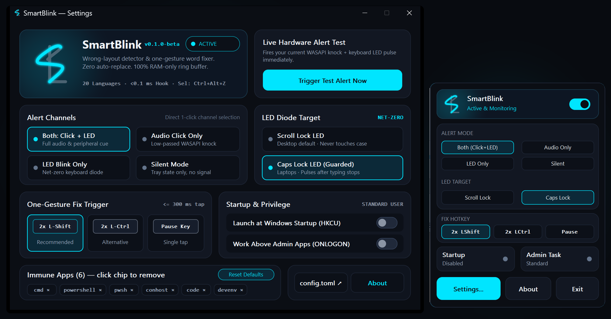

# SmartBlink

[-f59e0b?style=flat-square)](https://github.com/VKVstudio/SmartBlink/issues)
[](https://github.com/VKVstudio/SmartBlink/releases/tag/v0.1.0-beta)
[-0078d4?style=flat-square)](https://github.com/VKVstudio/SmartBlink/releases/tag/v0.1.0-beta)
[](LICENSE)

**Мгновенное оповещение о наборе в неверной раскладке на светодиод клавиатуры и исправление одним жестом для Windows 10/11. Сделано для разработчиков и всех, кто много печатает на нескольких языках и не хочет, чтобы автозамена сама переписывала код, пароли, команды терминала и имена собственные.**

**[Собрать из исходников (`cargo build --release`)](#запуск-сборка-одной-командой-или-готовый-exe)** · **[Скачать `smartblink.exe` (`v0.1.0-beta`)](https://github.com/VKVstudio/SmartBlink/releases/download/v0.1.0-beta/smartblink.exe)** · **[Все релизы](https://github.com/VKVstudio/SmartBlink/releases/tag/v0.1.0-beta)** · **[English README (`README.md`)](README.md)**



> **Ранняя бета-версия (`v0.1.0-beta`) - нужна обкатка в реальной работе:**
> Это публичная бета-сборка, а не финальный релиз 1.0. Основной движок хуков и пара `EN <-> RU` обкатаны в ежедневной живой работе на Windows 11. Остальные 18 языков и 43 системные раскладки проходят 49 автотестов напрямую по файлам `C:\Windows\System32\KBD*.DLL`, но синтетические тесты не заменят живую печать в разных редакторах, браузерах, мессенджерах и ноутбучных клавиатурах. Если на каком-то слове программа мигает зря, не замечает ошибку или странно ведёт себя в конкретном окне - напиши в [GitHub Issues](https://github.com/VKVstudio/SmartBlink/issues) пару раскладок и само слово.

## Знакомая боль

Когда печатаешь на двух-трёх языках и смотришь на клавиатуру, а не в монитор, сценарий всегда один: набираешь полстроки, поднимаешь глаза и видишь `Ghbdtn rfr ltkf` вместо `Привет как дела` (или `Руддщ цщкдв` вместо `Hello world`). Приходится зажимать Backspace, переключать раскладку и набирать всё заново.

Традиционные автопереключатели пытаются угадывать язык и переписывать слова прямо на лету. На обычном тексте это помогает, но стоит набрать консольную команду, SQL-запрос, переменную в camelCase, редкую фамилию, аббревиатуру или пароль в нестандартном поле, как автозамена срабатывает невпопад и ломает строку посреди мысли.

## Как работает SmartBlink

SmartBlink жёстко разделяет **обнаружение ошибки** и **замену текста**. Программа никогда не трогает набранный текст сама.

1. **Ты просто печатаешь.** Как только набранное слово не похоже на язык текущей раскладки, SmartBlink коротко мигает светодиодом на самой клавиатуре (`Scroll Lock` по умолчанию или защищённый `Caps Lock`) и проигрывает тихий 24-миллисекундный глухой щелчок через WASAPI. Ошибку замечаешь сразу, не отрывая взгляда от клавиш.
2. **Исправляешь только тогда, когда сам решишь.** Дважды нажми `Left Shift` (за 300 мс), и SmartBlink переведёт последнее слово или всю фразу, набранную в неверной раскладке, и переключит раскладку активного окна.
3. **Передумал?** Нажми двойной `Left Shift` ещё раз в течение 10 секунд, чтобы вернуть исходный текст и раскладку обратно. Если сигнал просто проигнорировать и печатать дальше, программа не вмешается. Проигнорируешь одно и то же слово три раза подряд - оно попадёт в белый список до конца сессии.

## Сравнение подходов

| Что важно в реальной работе | **SmartBlink (`v0.1.0-beta`)** | **Автоматические переключатели** | **Самописные макросы / скрипты** |
|---|---|---|---|
| Меняет ли текст сам во время печати? | **Никогда** (только по твоему жесту) | Да (может менять код, сленг и команды) | Только по хоткею без детекции |
| Сигнал светодиодом на самой клавиатуре | **Да** (возврат состояния LED + 24 мс клик) | Только звук или плашка на экране | Нет |
| Языки из коробки | **20 языков** (`131 КБ` суммарно) | Обычно 2 активных языка | Ручные таблицы символов |
| Поддержка `AltGr`, мёртвых клавиш и `AR`/`HE` | **Да** (автотесты по 45 системным `KBD*.DLL`) | Частично | Хрупко |
| Автоотключение в полях ввода паролей | **Да** (Windows UI Automation `IsPassword`) | Зависит от приложения | Нет |
| Сохранность буфера обмена при `Ctrl+Alt+Z` | **Да** (все форматы `HGLOBAL` байт в байт) | Часто только плоский текст | Затирает буфер обмена |
| Потребление памяти и размер файла | **`< 3 МБ` ОЗУ / `666 КБ` один `.exe`** | 20-40 МБ ОЗУ | Требует рантайм интерпретатора |
| Исходный код и работа с сетью | **MIT Open Source** (только в ОЗУ, без сетевых API) | Обычно закрытый код | По-разному |

## 20 языков и 45 системных раскладок Windows 11

Большинство утилит держат внутри жёстко зашитую таблицу `US QWERTY <-> RU ЙЦУКЕН` и ломаются, как только у пользователя стоит французская AZERTY, немецкая QWERTZ, чешская раскладка с буквами на цифровом ряду, польские диакритики через `AltGr`, испанские мёртвые клавиши, арабские двухсимвольные лигатуры `لا` или грузинские согласные на `Shift`.

SmartBlink строит карту клавиш для твоих установленных в Windows раскладок (`HKL`) напрямую через системный `ToUnicodeEx` по четырём слоям (`Base`, `Shift`, `AltGr`, `Shift+AltGr`) и оценивает слова по встроенным таблицам биграмм и триграмм (`assets/profiles/*.bin`). Каждый билд проходит автотест по всем 45 штатным драйверам `C:\Windows\System32\KBD*.DLL` из состава Windows 11:

| Группа языков | Языки (`20`) | Драйверы Windows 11 в автотестах (`45 DLL`) | Примеры: ввод в чужой раскладке -> результат |
|---|---|---|---|
| **Кириллица и славянские** | `RU`, `UK`, `BE`, `KK`, `PL`, `CS` | ЙЦУКЕН, Машинопись, UK-101, UK-Enhanced (`ґ`), Белорусская (`ў`), Казахская, Польская (Программистская и 214), Чешская (QWERTZ и QWERTY) | `ghbdtn rfr ltkf` -> `привет как дела`<br>`\heyn` -> `ґрунт`<br>`c2ktv` -> `сәлем`<br>`4e3tina` -> `čeština` |
| **Западная и Северная Европа** | `EN`, `DE`, `FR`, `ES`, `PT`, `IT`, `NL`, `SV` | US, UK, US-Intl, Немецкая QWERTZ, Швейцарская DE/FR, Французская AZERTY (Legacy, Standard, Бельгийская), Испанская и LatAm, Португальская и ABNT2, Итальянская и 142, Нидерландская, Шведская | `stra-e` -> `straße`<br>`c4est d2j0` -> `c'est déjà`<br>`tambi'en` -> `también`<br>`cora;'ao` -> `coração`<br>`ocks[` -> `också` |
| **Средиземноморье и турецкий** | `EL`, `TR` | Греческая (Standard, 220, 319, Polytonic), Турецкая Q и Турецкая F | `kalhm;era` -> `καλημέρα`<br>`g]naydin` -> `günaydın` |
| **Письменность справа налево (RTL)** | `AR`, `HE` | Арабская 101, 102 (`ذ` на `\`), 102-AZERTY, Иврит (Legacy, Standard и SI-2018) | `fb` -> `بلا` (лигатура `لا`)<br>`lsHgm` -> `مسألة`<br>`akuo` -> `שלום` |
| **Кавказские языки** | `HY`, `KA` | Армянская (Восточная, Западная, Фонетическая, Машинопись); Грузинская (QWERTY, Ergonomic, Legacy, MES) | `bar&` -> `բարև`<br>`gTxovT` -> `გთხოვთ` |

## Горячие клавиши по умолчанию

| Действие | Клавиша по умолчанию | Альтернативы в настройках |
|---|---|---|
| **Исправить последнее слово или фразу** | Двойной `Left Shift` (`<= 300 мс`) | Двойной `Left Ctrl` или одиночный `Pause/Break` |
| **Отменить последнее исправление** (до 10 с) | Тот же жест повторно (`2x Left Shift`) | Следует за выбранной клавишей исправления |
| **Перевести выделенный текст** | `Ctrl + Left Alt + Z` | Сохраняет все форматы буфера обмена байт в байт; не реагирует на правый `AltGr`, поэтому польская `AltGr+Z` (`ż`) работает штатно |

## Запуск: сборка одной командой или готовый `.exe`

### Вариант 1: Собрать самому из исходников (рекомендуется)

Утилите, которая работает с клавиатурой, не нужно верить на слово. У SmartBlink всего одна внешняя зависимость (`windows` crate от Microsoft), весь код открыт, а сборка собственного исполняемого файла занимает несколько секунд:

```powershell
git clone https://github.com/VKVstudio/SmartBlink.git
cd SmartBlink
cargo build --release
```

Готовый файл появится в `target\release\smartblink.exe` (`~666 КБ`). Прогнать все 49 автотестов (включая проверку по всем 45 системным драйверам `C:\Windows\System32\KBD*.DLL` твоей Windows 11):

```powershell
cargo test --release
```

### Вариант 2: Готовый `.exe` (для тех, кому лень ставить Rust и собирать)

Если не хочется ставить компилятор Rust и нужно просто скачать и запустить готовую сборку, возьми её напрямую в разделе **[GitHub Releases (`v0.1.0-beta`)](https://github.com/VKVstudio/SmartBlink/releases/tag/v0.1.0-beta)**:

- **[`smartblink.exe`](https://github.com/VKVstudio/SmartBlink/releases/download/v0.1.0-beta/smartblink.exe)** (`675 КБ`) - портативный одиночный файл. Просто положи в любую папку и запусти, установка не нужна.
- **[`SmartBlink-Setup-0.1.0-beta.exe`](https://github.com/VKVstudio/SmartBlink/releases/download/v0.1.0-beta/SmartBlink-Setup-0.1.0-beta.exe)** (`2.25 МБ`) - опциональный установщик (добавляет ярлык в меню «Пуск» и штатное удаление).

После запуска `smartblink.exe`:

1. **Левый клик** по иконке в трее (или повторный запуск `smartblink.exe`) открывает окно **Settings**. Нажми кнопку **Trigger Test Alert Now** в верхнем блоке, чтобы сразу услышать щелчок и увидеть мигание индикатора на клавиатуре.
2. **Правый клик** по иконке в трее открывает компактное меню для переключения в один клик: Пауза, Режим сигнала, Выбор светодиода, Клавиша исправления, Автозапуск и запуск с правами администратора.

## Почему программу безопасно ставить на рабочий ПК

- **Нажатия клавиш никогда не покидают оперативную память.** SmartBlink хранит только последние 256 физических скан-кодов в кольцевом буфере и 64 слота текущего слова. Оба буфера принудительно затираются нулями (`std::ptr::write_volatile`) при любом клике мыши, нажатии стрелок, смене окна, паузе в 3.5 секунды или выходе из программы.
- **В бинарнике нет сетевого кода.** Исполняемый файл линкует только стандартные библиотеки самой Windows (`user32`, `gdi32`, `ole32`, `mmdevapi`). Внутри нет HTTP-клиентов, телеметрии, автообновлений или отправки отчётов.
- **Автоматический иммунитет там, где он нужен.** Программа сама замолкает в полях ввода паролей (определяется через Windows UI Automation `CurrentIsPassword`), окнах активного ввода иероглифов (IME), на ссылках (`https://`), путях к файлам (`C:\...`), флагах консоли (`--release`) и в приложениях из списка исключений (`WindowsTerminal.exe`, `cmd.exe`, `powershell.exe`, `pwsh.exe`, `Code.exe`, `devenv.exe`, `idea64.exe`, `nvim.exe` - список редактируется прямо в окне настроек).
- **Нулевая задержка ввода.** Перехватчики `WH_KEYBOARD_LL` и `WH_MOUSE_LL` только кладут 16-байтную запись в кольцевой буфер и сразу возвращают управление ОС. В потоке хука нет ни аллокаций памяти, ни воспроизведения звука, ни проверки словарей.

## Частые вопросы

**Может ли SmartBlink сам заменить слово, пока я печатаю?**
Нет. Это первое правило в [`AGENTS.md`](AGENTS.md) и [`ARCHITECTURE.md`](ARCHITECTURE.md). Программа только подаёт сигнал светодиодом и тихим кликом. Текст и раскладка меняются исключительно после твоего двойного нажатия `Left Shift` (или выбранной клавиши) либо `Ctrl+Alt+Z` по выделенному тексту.

**Почему по умолчанию мигает `Scroll Lock`, а не `Caps Lock`?**
Если переключать `Caps Lock` в тот момент, когда пальцы печатают со скоростью 400 знаков в минуту, Windows может инвертировать регистр следующей буквы (`пРИВЕТ`). `Scroll Lock` находится на том же блоке индикаторов полноразмерной клавиатуры, но никак не влияет на регистр букв. Если у тебя компактный ноутбук, где есть только светодиод `Caps Lock`, выбери в настройках режим **Caps Lock (Guarded)**: он ждёт паузу 80 мс между нажатиями, мгновенно прерывает мигание при касании любой клавиши и возвращает исходное состояние `Caps Lock`.

**Как исправлять текст в окнах, запущенных от имени Администратора?**
По правилам изоляции привилегий Windows (UIPI) обычное приложение не может отправлять нажатия клавиш в окна, открытые от имени Администратора. Если нужно, чтобы SmartBlink работал и в них, включи переключатель **Run as Admin Task** в меню трея или в окне настроек. Он создаст задачу в Планировщике Windows (`ONLOGON`), и программа будет стартовать при входе в систему с нужными правами без всплывающих окон UAC.

## Документация и исходники

- [Архитектура и техническая спецификация (`ARCHITECTURE.md`)](ARCHITECTURE.md)
- [Исследование 20 языков и 45 драйверов раскладок (`.system/layouts_research.md`)](.system/layouts_research.md)
- [Справочник по `config.toml` (`docs/CONFIG.md`)](docs/CONFIG.md)
- [Модель приватности и безопасности (`docs/PRIVACY.md`)](docs/PRIVACY.md)
- [Сборка из исходников (`docs/BUILDING.md`)](docs/BUILDING.md)
- [Участие в разработке (`CONTRIBUTING.md`)](CONTRIBUTING.md)
- [Лицензии языковых профилей (`assets/profiles/LICENSES.md`)](assets/profiles/LICENSES.md)

## Лицензия

MIT License. Copyright (c) 2026 [VKV Studio](https://vkvstudio.com). Полный текст в файле [`LICENSE`](LICENSE).
